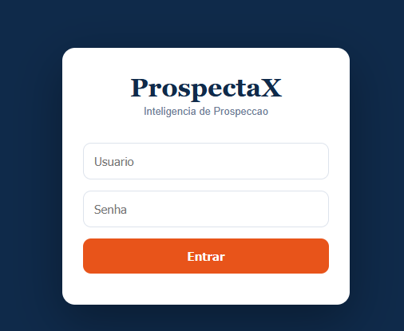
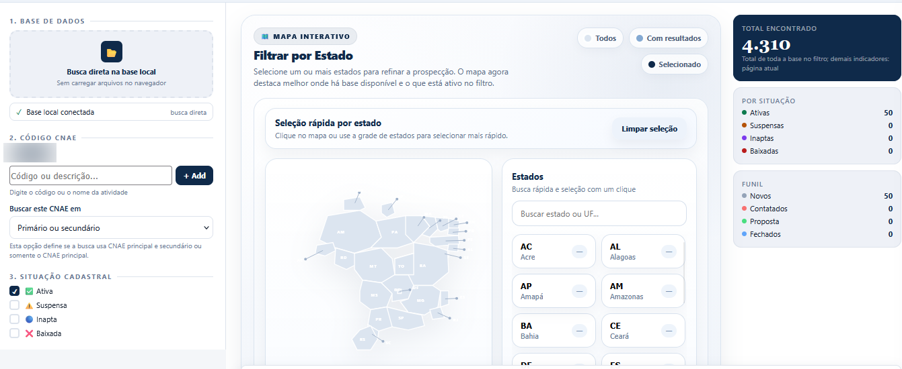

# ProspectaX — Prospecção de clientes

Ferramenta de prospeccao empresarial com servidor Python, consultas em DuckDB/Parquet, organizacao comercial e integracoes opcionais com fontes publicas.

A ferramenta roda no computador de quem a instala e é acessada pelo navegador. O download contém o programa; Python, dependências, base de empresas e serviços opcionais precisam ser preparados conforme as instruções abaixo.

## Comece por aqui

1. **Para instalar no Windows:** siga o [passo a passo de instalação](docs/INSTALACAO_WINDOWS.md).
2. **Para entender o que precisa:** leia [os requisitos](#o-que-precisa-para-funcionar).
3. **Para conhecer as funções:** consulte a tabela abaixo e os limites no final desta página.
4. **Para usar recursos externos:** veja [APIs](#como-cadastrar-suas-apis), [túnel](#como-funciona-o-tunel) e [base da Receita](#atualizador-da-receita).

## Telas da ferramenta

### Tela de acesso



### Pesquisa de empresas



A base de empresas utilizada nas capturas não acompanha o download do programa. Consulte as instruções do [atualizador da Receita](#atualizador-da-receita) para preparar sua própria base.

## O que a ferramenta oferece

| Área | Funções presentes | O que é necessário |
| --- | --- | --- |
| Prospecção | Pesquisar empresas por CNAE, estado, cidade e situação; aplicar filtros e exportar resultados. | Base local da Receita e índice compatível. Alguns filtros dependem das colunas disponíveis no índice. |
| Consulta de empresas | Consultar CNPJ e informações locais; complementar por fontes externas quando disponíveis. | Base local para os dados locais; internet e disponibilidade dos serviços para complementação. |
| Organização comercial | Favoritos, anotações, retornos, clientes salvos, buscas salvas e quadro de negociações. | Instalação própria e conta na ferramenta. Os registros são particulares dessa instalação. |
| Parceiros e negócios | Vitrine de parceiros aprovados, catálogo, cotações, propostas de fornecedores e cálculo de margem. | Cadastrar os próprios parceiros e produtos. Não acompanha uma carteira pronta de fornecedores ou clientes. |
| Carteira de clientes | Importar uma carteira, consultar os CNPJs e identificar atividades para novas pesquisas. | Arquivo da própria pessoa e base local. A importação de XLSX depende do carregamento da biblioteca de planilhas pela internet. |
| Pesquisa e propostas | Pesquisar sites e contatos com fontes, confirmar contatos e preparar rascunhos e PDFs. | Fontes acessíveis; NVIDIA e buscador configurados para as funções que os utilizam. Existe roteiro local identificado quando a IA não está configurada. |
| Radar de oportunidades | Consultar editais, contratos, obras, notícias, marcas e estatísticas de comércio exterior. | Internet e resposta das fontes públicas. IA e pesquisa web complementar são opcionais. |
| Produtos para importar | Consultar o catálogo integrado e comparar anúncios. | Para o catálogo AliExpress, cadastro, aplicativo aprovado e credenciais próprias; leitura por link depende do site. |
| Consultas públicas | Consultar registros PGFN importados, sanções CGU e abrir serviços oficiais. | Base PGFN separada para dívida ativa; chave própria para CGU. Certidões podem exigir autenticação ou CAPTCHA no portal oficial. |

As funções acima descrevem recursos presentes no código. Não significam garantia de dados completos, contatos corretos, vendas, crédito aprovado ou disponibilidade dos serviços. Consulte [o que foi efetivamente testado](#validacao-e-limitacoes-desta-publicacao).

## O que esta neste repositorio

- Modulos Python na raiz, preservando os caminhos de importacao do programa.
- Iniciadores `.bat` para Windows na raiz.
- Guias e PDFs em [`docs/`](docs/).
- Dependencias de Python em [`requirements.txt`](requirements.txt).

As quatro partes recebidas foram reunidas: backend, telas em `site/`, atualizador em `_ATUALIZADOR_RECEITA/` e documentacao. A base empresarial e os dados privados da instalacao nao fazem parte do repositorio.

Salvar o codigo no GitHub nao coloca o sistema no ar. Este repositorio nao configura hospedagem, publicacao de site ou tunel.

## O que precisa para funcionar

Baixar o ZIP entrega o codigo; ainda e necessario preparar o computador. Cada pessoa usa uma instalacao independente, com sua propria base, cadastros e configuracoes.

| Componente | Quando e necessario |
| --- | --- |
| Python 3.12 e dependencias | Para iniciar o programa. Baixe Python pelo [site oficial](https://www.python.org/downloads/windows/). |
| Base da Receita em Parquet e indice DuckDB | Para pesquisar empresas reais. Pode usar uma base compativel existente ou gerar pelo atualizador incluido. |
| Chaves proprias de APIs | Somente para os recursos que pedem essas chaves. O download nao inclui credenciais do proprietario. |
| Cloudflared | Somente para gerar um link de acesso externo. Nao e necessario para usar apenas no proprio computador. |
| Internet e espaco em disco | Para baixar a base e usar servicos externos. O atualizador exige pelo menos 60 GB livres; recomenda 80 GB ou mais em SSD, conforme o volume. |

## Baixar e entender o GitHub

Na pagina principal do repositorio, clique em **Code > Download ZIP** para baixar o codigo. Depois, extraia o ZIP no computador antes de executar os comandos abaixo.

O repositorio publico permite leitura e copia. Isso nao concede acesso de escrita ao original. Nao foi adicionado nenhum colaborador nem concedido acesso de escrita a terceiros nesta organizacao. O historico do Git guarda as versoes enviadas do codigo; os cadastros e bancos privados precisam de backup separado.

Veja tambem [`docs/COMO_USAR_O_GITHUB.md`](docs/COMO_USAR_O_GITHUB.md).

## Preparar o Python

Use Python 3.12. No Windows, execute na pasta do projeto. O [guia para Windows](docs/INSTALACAO_WINDOWS.md) explica onde abrir o terminal e a ordem das etapas:

```powershell
python -m venv .venv
.\.venv\Scripts\python.exe -m pip install -r requirements.txt
```

No Linux:

```sh
python3 -m venv .venv
.venv/bin/python -m pip install -r requirements.txt
```

Para iniciar no Windows, use o Python desse ambiente:

```powershell
.\.venv\Scripts\python.exe iniciar_local.py
```

Abra o endereco local informado pelo programa no navegador. O acesso inicial e **usuario `admin`, senha `admin123`**, mantido por solicitacao expressa do proprietario. Essa e uma senha padrao publica da ferramenta, e nao uma credencial particular extraida da instalacao original. Instalacoes com cadastros existentes preservam esses cadastros e suas senhas.

Opcionalmente, antes da primeira execucao, `PROSPECTAX_ADMIN_PASSWORD` permite definir outra senha inicial, com pelo menos 16 caracteres. Nenhum cadastro de producao foi transferido para este repositorio.

Para pesquisar empresas reais, disponibilize sua base em `dados_parquet/` ou configure `PROSPECTAX_DATA_DIR` para a pasta externa que ja possui. Os testes desta copia utilizaram somente uma base sintetica temporaria, que nao foi instalada como dado real.

## Atualizador da Receita

Os scripts de atualizacao e geracao do indice acompanham o codigo. Para instalar suas dependencias adicionais:

```powershell
.\.venv\Scripts\python.exe -m pip install -r requirements_atualizador.txt
```

O atualizador baixa os ZIPs das fontes oficiais, converte os CSVs em Parquet e gera `prospectax_index.duckdb`. A base nacional nao vem dentro do ZIP do GitHub.

Para consultar os meses e arquivos disponiveis na internet, sem baixar a base completa:

```powershell
.\.venv\Scripts\python.exe _ATUALIZADOR_RECEITA\atualizar_base_receita.py --dry-run
```

Para baixar e preparar a base completa, feche primeiro o ProspectaX, confira o espaco livre e execute:

```powershell
.\.venv\Scripts\python.exe _ATUALIZADOR_RECEITA\atualizar_base_receita.py --replace
```

Esse processo pode demorar muitas horas. A substituicao final preserva a base anterior em backup. Consulte [`_ATUALIZADOR_RECEITA/README_ATUALIZADOR.txt`](_ATUALIZADOR_RECEITA/README_ATUALIZADOR.txt) antes de executar. Foram testadas conversao e geracao do indice com dados sinteticos; o download nacional e a troca de uma base real nao foram executados nesta revisao.

## Como cadastrar suas APIs

1. Entre na sua instalacao com uma conta de administrador e abra as configuracoes do recurso desejado.
2. Use o link do provedor quando disponivel, ou acesse seu site oficial, para criar sua propria conta e obter uma chave.
3. Volte ao ProspectaX, cole a chave no campo correspondente e salve. O cadastro no provedor e a obtencao da chave sao etapas manuais; o link do GitHub nao faz isso automaticamente.

As configuracoes gerais ficam no botao de configuracoes. Modulos como NVIDIA, busca Brave, AliExpress e consultas publicas possuem configuracoes nas suas respectivas telas. Os recursos que exigem uma chave dependem dela para funcionar. Outras consultas a fontes publicas nao exigem chave. Condicoes, permissoes e eventuais cobrancas dependem de cada provedor.

Cada instalacao deve usar credenciais proprias. Nao compartilhe suas chaves no GitHub, em documentos publicos ou em mensagens de suporte.

## Como funciona o tunel

O botao de Link Online foi mantido, mas o executavel de terceiros nao acompanha o download e nao e instalado automaticamente pelo botao.

1. Baixe o Cloudflared para seu Windows e arquitetura nos [lancamentos oficiais da Cloudflare](https://github.com/cloudflare/cloudflared/releases).
2. Se o arquivo baixado tiver outro nome, renomeie-o para `cloudflared.exe`.
3. Coloque-o na raiz do projeto, na mesma pasta de `prospector_api_parquet.py`.
4. Inicie a ferramenta. Antes de abrir acesso publico, substitua a senha padrao `admin123` por uma senha propria.
5. Use o botao de Link Online para solicitar o tunel e obter o link daquela instalacao.

O link aponta para o computador que iniciou o tunel, e nao para a instalacao do proprietario do repositorio. Esse computador precisa permanecer ligado, com a ferramenta, o tunel e a internet funcionando. O link temporario pode mudar quando um novo tunel for iniciado.

Nenhum tunel foi aberto nesta revisao. A execucao real do tunel no Windows ainda precisa ser validada no computador de destino.

## Configuracoes e dados privados

As chaves de APIs sao opcionais para o codigo-base e devem ser informadas pelo ambiente do processo ou pelos campos protegidos da aplicacao. O programa nao carrega arquivos `.env` automaticamente. Nunca coloque chaves reais no codigo ou nos exemplos do GitHub.

Variaveis de configuracao principais:

| Variavel | Uso |
| --- | --- |
| `PROSPECTAX_HOST` | Endereco de escuta; o padrao desta copia e `127.0.0.1`. |
| `PROSPECTAX_PORT` | Porta local, normalmente `8765`. |
| `PROSPECTAX_ADMIN_PASSWORD` | Substitui a senha inicial padrao em uma instalacao nova. |
| `PROSPECTAX_SITE_DIR` | Pasta das telas e dos JSONs locais de usuarios. |
| `PROSPECTAX_PRIVATE_DIR` | Pasta dos bancos e configuracoes privados. |
| `PROSPECTAX_DATA_DIR` | Pasta da base Parquet, mantida fora do Git. |
| `PROSPECTAX_LICENSE_API` | Endpoint de licenciamento, quando essa integracao for usada. |
| `PROSPECTAX_LICENSE_SECRET` | Chave privada de assinatura de licencas; sem valor padrao no codigo. |

O modo de licenciamento conserva a configuracao original do programa e nao foi validado contra um servico real. O endpoint particular da instalacao de origem foi retirado. A protecao de chaves por Windows DPAPI descrita nos guias depende do Windows; o funcionamento das integracoes com chaves no Linux nao foi validado.

## Antes de enviar outros arquivos

O `.gitignore` exclui dados, JSONs, licencas locais, chaves, bancos, backups, executaveis, configuracoes locais do Cloudflare e arquivos compactados. Ele reduz envios acidentais, mas nao remove segredos gravados dentro de codigo ou documentos.

Revise novos arquivos antes de publica-los. As bases de clientes, usuarios, historicos e chaves devem ficar apenas no ambiente privado. Nao use `git add -f` para contornar essas exclusoes.

Consulte [`docs/REVISAO_PARA_PUBLICACAO.md`](docs/REVISAO_PARA_PUBLICACAO.md) para os ajustes desta copia. Os guias historicos descrevem a instalacao original; seus relatos de testes nao comprovam testes nesta copia.

## Capacidade e limites

O tamanho da base que pode ser utilizado depende do espaço em disco, da memória, do computador e do índice criado. Não foi medido um limite máximo de empresas nem o desempenho da base nacional completa nesta preparação. A ferramenta não deve ser apresentada como ilimitada.

- **Disco:** o atualizador recusa a carga nacional com menos de 60 GB livres e recomenda 80 GB ou mais em SSD. Esse valor é uma referência inicial; não garante espaço suficiente para qualquer competência e todos os arquivos temporários.
- **Memória:** o gerador de índice configura, por padrão, um limite de 6 GB para o DuckDB. Python, conversão e sistema operacional também consomem memória; 6 GB não representam o consumo total do computador.
- **Carteira:** até 500 CNPJs por importação; a interface limita o arquivo a 2 MB.
- **Quadro de negociações:** exibe até 500 cartões, conforme a implementação atual.
- **Radar:** até 300 oportunidades salvas por usuário; resultados e exportações seguem os limites e a paginação de cada fonte.
- **NVIDIA:** limite inicial de 20 chamadas por usuário/dia, ajustável de 1 a 200 pelo administrador. Isso não substitui os limites ou a cobrança do provedor.

Contatos encontrados precisam de conferência. As consultas públicas não substituem uma análise completa de crédito. As estatísticas de comércio exterior são agregadas e não identificam automaticamente compradores individuais. Cotações e propostas não processam pagamentos nem representam envio automático de mensagens.

## Validacao e limitacoes desta publicacao

**Verificado com dados sintéticos temporários:** instalação das dependências, conversão de CSV em ZIP para Parquet, geração do índice, inicialização local, autenticação, login pelo navegador, busca pela interface e exibição do resultado. As páginas dos módulos também foram abertas.

**Ainda não validado nesta preparação:** download nacional completo da Receita, desempenho com milhões de registros, todos os fluxos de negócio, chamadas com chaves reais de APIs, túnel real e iniciadores `.bat` executados no Windows. A verificação no navegador foi feita em Chromium no Linux; os recursos de proteção de chaves por Windows DPAPI dependem do Windows.

Cada pessoa precisa configurar suas próprias contas e dados. Instalar uma cópia não conecta automaticamente ao computador, às APIs ou ao túnel do proprietário do repositório.
